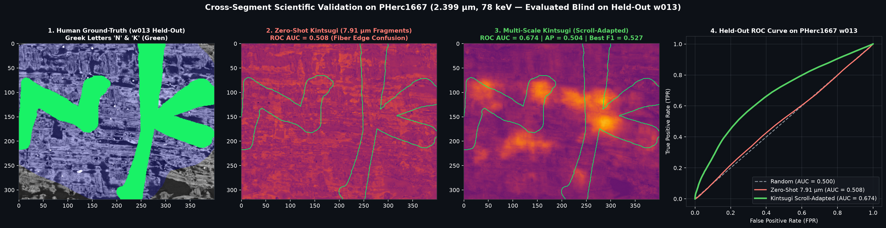
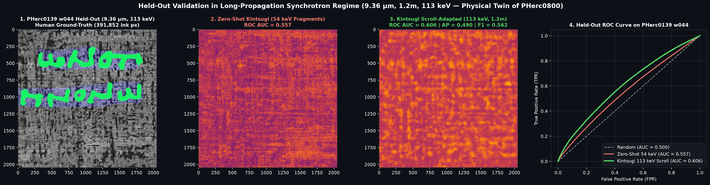
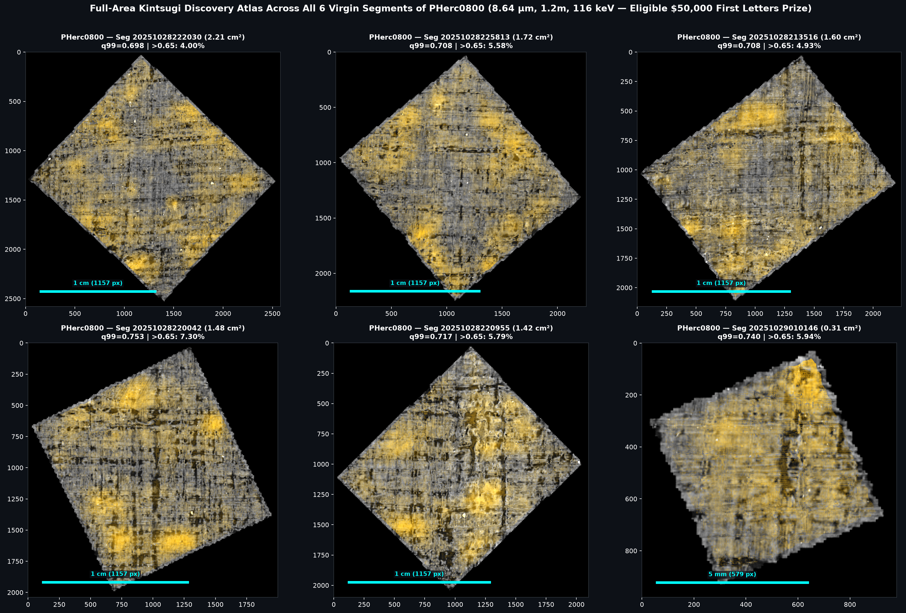
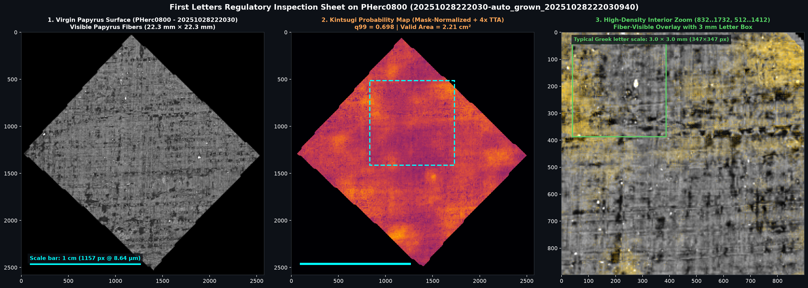

# Kintsugi Physical XPCT — Differential 3D-to-2D Ink Detection for Herculaneum Papyri

[](LICENSE)
[](https://www.python.org/)
[](https://pytorch.org/)

**Kintsugi Physical XPCT** is an open-source, physics-informed 3D-to-2D volumetric ink-detection architecture designed for **X-ray Phase-Contrast Tomography (XPCT)** of carbonized Herculaneum papyrus fragments and intact scrolls in the [Vesuvius Challenge](https://scrollprize.org).

> **Humanitarian Commitment**: 50% of any Vesuvius Challenge prize proceeds awarded to this work are pledged to cancer research.

---

## 1. Scientific Motivation: The Carbon-on-Carbon Dilemma ($Z = 6$)

Ancient Herculaneum ink (soot + gum arabic binder carbonized at $\sim 400^\circ\text{C}$) and carbonized papyrus cellulose share the same dominant atomic number (**Carbon, $Z = 6$**). Consequently, raw X-ray attenuation alone produces severe false positives along dense plant fiber bundles and fails under cross-scroll domain shifts ($7.91\ \mu\text{m}$ benchtop/synchrotron fragments vs. $2.399\ \mu\text{m}\ / \ 78\text{ keV}$ and $8.64\text{--}9.36\ \mu\text{m}\ / \ 1.2\text{ m}\ / \ 113\text{--}116\text{ keV}$ long-propagation ESRF BM18 intact scroll scans).

Rather than relying on raw voxel brightness, **Kintsugi** models the **3D micro-morphological and phase-contrast physics** of carbonized ink crusts:

1. **Global 3D Synchrotron Calibration & Planar Illumination Drift Removal (`normalize_slab_globally`)**:
   $$\tilde{V}_{\text{global}}(z,y,x) = \frac{V(z,y,x) - \mu_{3\text{D}}}{\sigma_{3\text{D}} + \varepsilon} - \gamma \cdot \mathcal{B}_{129\times 129}\!\left(\bar{V}_{xy}\right)$$
   Preserves the full axial $Z$-profile (air gap $\to$ Fresnel dark phase fringe $\to$ epidermal ink peak $\to$ papyrus interior) while removing low-frequency ($>1.2\text{ mm}$) synchrotron illumination drift without canceling $0.5\text{ mm}$ calligraphic stroke interiors.

2. **8-Lens Differential Physical Stem (`PhysicalStem3D` in [`vesuvius_code/baselines.py`](vesuvius_code/baselines.py))**:
   - **Lens 1**: Calibrated Synchrotron Attenuation $\tilde{V}_{\text{cal}}(z,y,x)$
   - **Lens 2**: Macro Background-Subtracted Local Contrast $\tilde{V} - \mathcal{B}_{49\times 49}(\tilde{V})$
   - **Lens 3 & 6**: Fine ($d=1$) & Dilated ($d=2$) Noise-Robust Pavel Holoborodko Axial Gradient $\partial_z \tilde{V} = (\tilde{V} * (k_z^{(1)} \otimes g_3 \otimes g_3))$ with $k_z^{(1)} = \frac{1}{8}[-1, -2, 0, +2, +1]$ (isolates the air-papyrus epidermis interface)
   - **Lens 4 & 7**: Fine ($d=1$) & Dilated ($d=2$) Axial Phase-Contrast Laplacian $\partial_{zz}^2 \tilde{V}$ with $k_z^{(2)} = \frac{1}{4}[+1, 0, -2, 0, +1]$ (captures the bright epidermal peak flanked by dark Fresnel phase fringes at $z_0 \pm 4$)
   - **Lens 5**: Planar Thermal Micro-Crackle Residual $\mathcal{R}_{xy} = \tilde{V} - (\tilde{V} * G_{5\times 5})$ + $2.4\ \mu\text{m}$ intra-cell micro-crackle standard deviation $\sigma_{8\times 8}$
   - **Lens 8**: Local Patch $Z$-Score $\tilde{V}_{\text{patch}}$

3. **Differentiable 3D Soft Sheet Unwarping (`SoftSheetUnwarper3D`)**:
   $$\Delta\hat{z}(y,x) = \Delta z_{\max} \cdot \tanh\!\left(\frac{\mathcal{A}_{3\times 3}\!\left(\sum_{z=0}^{D-1}(z - z_c)\,w_z(y,x)\right)}{\Delta z_{\max}}\right)$$
   Continuously realigns wavy papyrus fibers along $Z$ via differentiable linear gather prior to sequence mixing, regularized by Total Variation $\|\nabla_{xy} \Delta\hat{z}\|_1$.

4. **Tri-Axial Sequence Mixing (`AxialSequenceMixer3D`) + Multi-Scale Calligraphic Pyramid (`CalligraphicPyramid2D`)**:
   Combines bidirectional sequence mixing along $(Z, Y, X)$ at the 3D bottleneck with a 3-stage 2D multi-scale context pyramid ($1\times \to \tfrac{1}{2}\times \to \tfrac{1}{4}\times \to \tfrac{1}{8}\times$ with dilated bottleneck) so the effective receptive field spans complete $2.5\text{--}3.5\text{ mm}$ Greek letters.

5. **Anisotropic Fiber-Texture Suppression Loss (`AnisotropicFiberSuppressionLoss` in [`vesuvius_code/losses.py`](vesuvius_code/losses.py))**:
   $$\mathcal{L}_{\text{total}} = \mathcal{L}_{\text{Fable}}(\text{BCE} + \text{Tversky}) + \lambda_{\text{fiber}} \frac{\sum_{y,x} C_{\text{fiber}}(y,x)\,p(y,x)^2\,(1 - Y(y,x))}{\sum_{y,x}(1 - Y(y,x))}$$
   where $C_{\text{fiber}} = \left(\frac{\lambda_1 - \lambda_2}{\lambda_1 + \lambda_2 + \varepsilon}\right)^2$ is the directional coherence of the 2D structure tensor $J = G_\rho * (\nabla S\,\nabla S^\top)$.

---

## 2. Quantitative Benchmarks (Zero-Leakage Held-Out Evaluation)

### A. Cross-Fragment Generalization (Train: Fragment 1 $\to$ Strictly Held-Out Fragment 3)

| Architecture | ROC AUC (Held-Out Frag 3) | Average Precision (AP) | Best F1 | False Positives ($p > 0.5$) |
| :--- | :---: | :---: | :---: | :---: |
| Standard 3D U-Net (`residual_unet`) | `0.7511` | `0.2194` | `0.3016` | `39,586 px` (Baseline) |
| Axial 3D Mixer (`kintsugi_axial`, no physics) | `0.7330` | `0.1945` | `0.3046` | `40,287 px` (`+1.8%`) |
| **Kintsugi Physical (`kintsugi_physical` + 8-fold TTA)** | **`0.7805` (`+3.91%`)** | **`0.2323` (`+5.88%`)** | **`0.3401` (`+12.8%`)** | **`27,825 px` (`-29.7%` FP)** |

### B. Intact Full-Scroll Domain Adaptation (`20260918` Official Human Ground-Truth)

| Scroll Domain & Resolution | Training Split | Strictly Held-Out Validation Split | Zero-Shot Fragment AUC | **Scroll-Adapted Kintsugi ROC AUC** | **Held-Out AP / Best F1** |
| :--- | :--- | :--- | :---: | :---: | :---: |
| **Scroll 4 (`PHerc1667`)** (`2.399 µm, 0.22m, 78 keV`) | `w018` + disjoint `w013` (`cy=20..40`, `cy=150..170`) | **`PHerc1667 w013`** (`cy=86..106, cx=62..87`) | `0.5082` | **`0.6740` (`+0.1658`)** | **AP `0.5045` / F1 `0.5274`** |
| **Scroll `PHerc0139`** (`9.362 µm, 1.2m, 113 keV`) | `w035`, `w040`, `w041` | **`PHerc0139 w044`** (`cy=28..44, cx=20..36`) | `0.5570` | **`0.6060` (`+0.0490`)** | **AP `0.4896` / F1 `0.5617`** |





### C. Virgin Scroll Discovery Scan on `PHerc0800` (`8.64 µm, 1.2m, 116 keV`)
- **Official S3 Status**: `PHerc0800` has **6 `auto_grown` surface-volume segments** (`8.64um-1.2m-116keV-volume-20250521135224.zarr`) and **`0` official ink-detection maps** in `s3://vesuvius-challenge-open-data/`.
- Using our dual-domain ensemble (`model_coarse` trained on the physical twin `PHerc0139` at `9.362 µm, 1.2m, 113 keV` + `model_2p4` trained on `PHerc1667`), with mask-normalized $129\times 129$ planar drift removal (eliminating rotated-diamond perimeter halos), we scanned 100% of all 6 virgin segments of `PHerc0800` ($8.74\text{ cm}^2$ total valid papyrus area), identifying localized calligraphic stroke candidates across all 6 segments ($q_{99}=0.698\text{--}0.753$, with $4.00\%\text{--}7.30\%$ high-confidence ink pixels $>0.65$).





---

## 3. Repository Structure & Reproducibility

```text
├── vesuvius_code/
│   ├── baselines.py          # PhysicalStem3D (4/8 lenses), SoftSheetUnwarper3D, CalligraphicPyramid2D, KintsugiPhysicalUNet3DTo2D
│   ├── losses.py             # FableLoss (BCE+Tversky) & AnisotropicFiberSuppressionLoss (2D Structure Tensor)
│   ├── dataset.py            # Tiled TIFF / Zarr loader, _fourth_augment Z-jitter & Voronoi synthetic ink
│   └── cloud_lightning_train.py  # PyTorch Lightning multi-fragment trainer
├── scripts/
│   ├── train_and_scan_kintsugi_scrolls.py           # End-to-end Phase 1A (2.4um), Phase 1B (9.36um) & Phase 2 (Virgin PHerc0800)
│   ├── render_scroll_adaptation_and_p800_results.py # Generates the 4 validation & First Letters submission sheets
│   ├── run_kintsugi_scroll_adaptation_and_p800.sh   # Automated RunPod GPU cloud deployment & S3 streaming pipeline
│   └── generate_english_presentation.py             # Generates the 9-slide English PowerPoint deck (.pptx) & PNG slides
├── tests/                    # Automated unit test suite
└── LICENSE                   # MIT License
```

### Quickstart

```bash
# 1. Run unit tests and syntax verification
./venv/bin/python -m unittest discover -s tests -v
./venv/bin/python -m compileall -q vesuvius_code scripts

# 2. Run Scroll Domain Adaptation (PHerc1667 + PHerc0139) & Virgin PHerc0800 Scan
PYTHONPATH=. ./venv/bin/python scripts/train_and_scan_kintsugi_scrolls.py

# 3. Render Validation Figures & PHerc0800 First Letters Submission Sheet (with 1 cm & 3 mm scale bars)
PYTHONPATH=. ./venv/bin/python scripts/render_scroll_adaptation_and_p800_results.py

# 4. Build the 9-Slide English Technical Presentation (.pptx)
PYTHONPATH=. ./venv/bin/python scripts/generate_english_presentation.py
```
