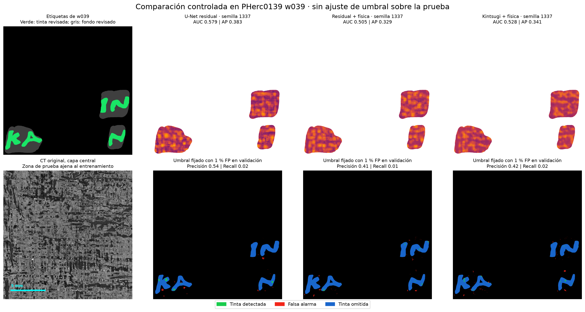
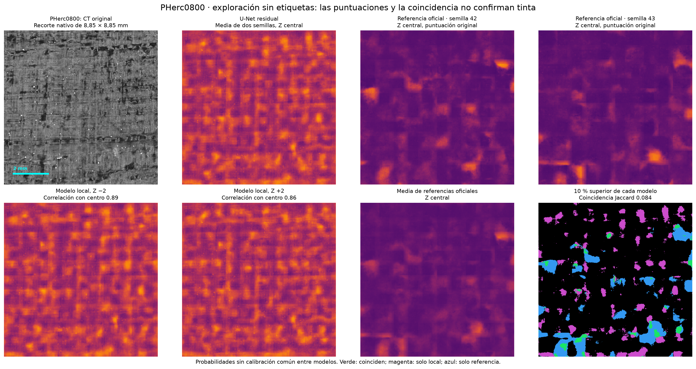
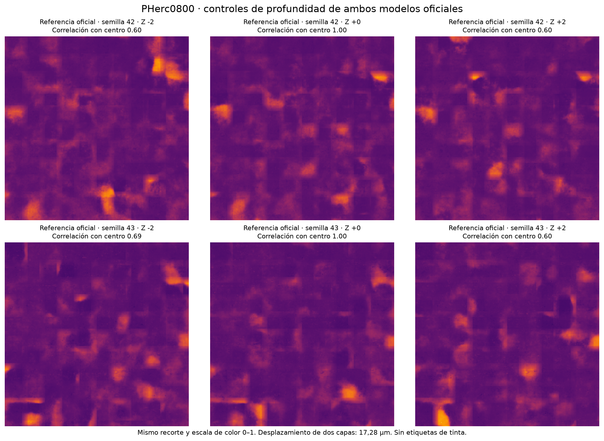
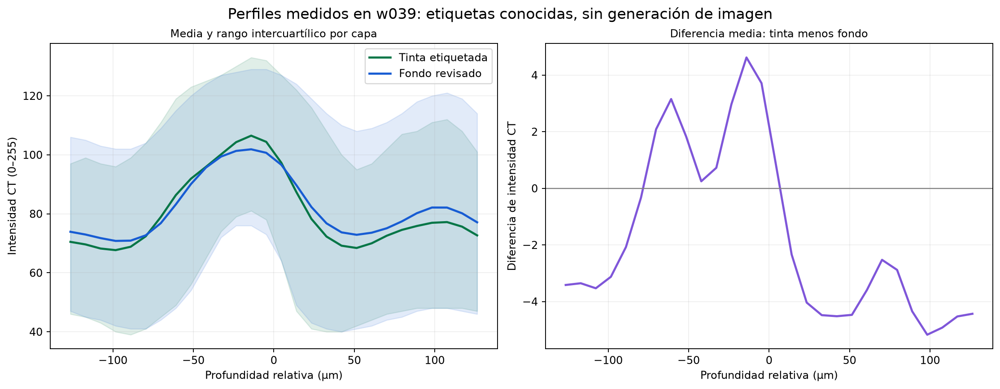

# Ensayo controlado de tinta sobre papiro carbonizado — 25 de octubre de 2026

## Resultado

Este ensayo corto no demuestra una ventaja de Kintsugi Physical frente al U-Net residual sencillo. En el segmento de prueba w039, el U-Net residual obtiene AP media **0,3616** y Kintsugi Physical **0,3567**. La variante residual con filtros físicos queda en **0,3299**. La referencia de AP sin capacidad de ordenar tinta es la prevalencia observada: **0,3186**.

En el recorte explorado de PHerc0800 no se han identificado letras inequívocas. Los mapas locales siguen claramente la estructura del papiro y coinciden poco con las zonas destacadas por los modelos oficiales. Esto no demuestra ausencia de tinta; tampoco permite presentar las manchas como tinta confirmada.

**Gasto total registrado en la consulta posterior al cierre: 0,2820047972 USD. Saldo: 6,5586198725 USD. Todos los pods y volúmenes creados para el ensayo fueron eliminados y su ausencia fue comprobada.**

## Protocolo fijado antes de abrir la prueba

- Entrenamiento: PHerc0139 w035 y w040, recortes nativos de 2048 × 2048 píxeles.
- Selección de pesos y umbrales: PHerc0139 w041.
- Prueba final: PHerc0139 w039, ventana de chunks `cy=22..38, cx=19..35`.
- La ventana de prueba se eligió por cobertura de la máscara de supervisión, sin consultar valores de tinta ni predicciones. Se evaluaron exclusivamente sus **482.384 píxeles revisados**, con **153.689 positivos**.
- Tres variantes, semillas 1337 y 2027, 400 pasos por ejecución, lote de 6, parches de 128 × 128 y 16 capas centrales a 9,362 µm.
- Mismo AdamW, tasa inicial 0,0015, calendario coseno, pérdida BCE + Tversky y secuencia de muestreo/aumentos para cada semilla. Sin profesores, tinta sintética ni penalización de fibras.
- Pesos elegidos por AP en validación cada 100 pasos. Inferencia idéntica con stride 96 y sin TTA. Umbrales fijados con w041 y aplicados sin recalibración a w039.
- El mezclador axial utiliza explícitamente el backend **fallback convolucional**. No se ha compilado ni probado Mamba CUDA en este ensayo.
- Los pasos de optimización son iguales; los parámetros y el coste de cómputo de las arquitecturas no son idénticos.

El protocolo completo está en [controlled_ink_20261025.json](../configs/controlled_ink_20261025.json). Las fuentes CT, chunks y huellas se guardan en `data/controlled_ink_20261025/*.source.json` y `hashes.json`. No faltó ningún chunk de los cinco recortes descargados. Se reutilizaron las etiquetas locales disponibles; su proceso original de anotación y registro no fue reauditado en esta ejecución.

## Resultados sobre w039

| Modelo | Parámetros | AP semilla 1337 | AP semilla 2027 | AP media | AUC media |
|---|---:|---:|---:|---:|---:|
| U-Net residual | 282.659 | 0,3827 | 0,3404 | **0,3616** | **0,5505** |
| Residual + física | 285.828 | 0,3293 | 0,3305 | 0,3299 | 0,5050 |
| Kintsugi + física | 296.164 | 0,3411 | 0,3723 | 0,3567 | 0,5317 |

El brillo de la capa central da AUC **0,5043** y AP **0,3243**. El promedio de intensidad en profundidad da AUC **0,4601** en la dirección de mayor brillo. Son controles descriptivos de intensidad, sin elegir su signo con las etiquetas de prueba.

Con los umbrales que maximizaban F1 en validación, los modelos marcan gran parte del fondo de prueba como tinta: alrededor de 635.000–672.000 falsos positivos por millón de píxeles revisados. Por ello un F1 cercano a 0,48 no representa lectura útil; marcar todos los píxeles como tinta daría F1 aproximadamente 0,4832 en esta máscara.

También se fijó, usando solo negativos de validación, un umbral con aproximadamente 1 % de falsos positivos. Al transferirlo a w039, el recall de las seis ejecuciones es únicamente **1,3–2,7 %**. Hay un problema importante de transferencia y calibración.

Los valores completos y ambos puntos de operación están en [metrics.json](../runs/controlled_ink_20261025/metrics.json). Los F1 máximos calculados sobre prueba se conservan únicamente con el sufijo `diagnostic`; no se utilizan para elegir el umbral informado.

## PHerc0800: comparación exploratoria

- Segmento `20251028222030-auto_grown_20251028222030940`, ventana nativa `cy=6..14, cx=6..14`.
- Recorte de 1024 × 1024 píxeles: **8,85 × 8,85 mm**, a **8,64 µm/píxel**, sin ampliar imágenes de una pirámide inferior.
- Modelo local seleccionado exclusivamente por AP media de validación: **U-Net residual**. Se promedian sus dos semillas.
- Referencias: `scrollprize/ink_9um`, semillas 42 y 43, checkpoint `step-075000.pth`, reconstruidas con su código original y carga estricta de pesos. Cada referencia tiene 34.546.498 parámetros y su normalización robusta original.
- Se conservan todas las probabilidades originales y las ventanas Z −2, 0 y +2. No se usa el máximo entre profundidades para aumentar artificialmente las detecciones.
- w039 y w044 están entre los datos de entrenamiento publicados de las referencias oficiales. Por tanto, sus resultados no se puntúan allí como una comparación independiente; las referencias se usan únicamente en PHerc0800 sin etiquetas.

El Jaccard entre el 10 % superior de puntuaciones del modelo local y la media oficial en Z central es **0,0838**. No es una tasa de aciertos de tinta. Las correlaciones del modelo local entre Z central y Z ±2 son 0,892 y 0,860; una textura de fibras también puede permanecer estable entre capas.

Las referencias oficiales usan suavizado de etiquetas, por lo que su escala numérica no está calibrada de la misma manera que la de los modelos locales. Las puntuaciones altas, la estabilidad en Z o el acuerdo entre modelos no sustituyen etiquetas independientes ni una lectura experta.

## Qué muestran las capas CT

Los perfiles medios de intensidad de tinta etiquetada y fondo revisado en w039 difieren en unas pocas unidades sobre una escala de 0–255, con un solapamiento grande de sus rangos intercuartílicos. Esto es compatible con un contraste de intensidad débil; no demuestra identificación química de tinta frente a carbono.

## Cambios y verificación

- AUC corregida para asignar el rango medio a puntuaciones empatadas. Las predicciones constantes producen ahora AUC 0,5, independientemente del orden de etiquetas.
- AP y selección de F1 exactas por grupos de empates, sin el muestreo aleatorio de 400.000 píxeles del script anterior.
- Eliminada la inversión automática de la predicción en función del resultado observado en validación.
- El script anterior exige el checkpoint entrenado: ya no permite presentar pesos aleatorios como referencia si falta el archivo.
- Nuevo ejecutor con límite acumulado de 5 USD, guardia independiente, respaldo de artefactos y limpieza por IDs creados en esa ejecución. No publica en GitHub.
- Eliminado el commit/push automático del lanzador antiguo. El ensayo se ejecutó con el nuevo lanzador.
- **98 pruebas automáticas pasadas**. Los tres modelos pasaron además una comprobación local de propagación y gradientes.
- Se comprobó que los seis checkpoints descargados coinciden con sus SHA-256 congelados. Sus seis mapas de prueba reproducen exactamente AP, AUC, F1, precisión, recall y FP/Mpix en ambos umbrales almacenados.
- Referencias oficiales cargadas estrictamente y ejecutadas en la RTX 4090 con PyTorch 2.8.0 + CUDA 12.8.

Los pesos, mapas originales y figuras permanecen en `runs/controlled_ink_20261025/`; los datos CT y las referencias descargadas, en `data/controlled_ink_20261025/`. No se han sustituido los resultados ni pesos de los experimentos anteriores. Los cambios están en la rama local `feat/controlled-ink-benchmark`.

## Coste y cierre

| Intento | Ubicación | Pod | Volumen | Resultado |
|---|---|---|---|---|
| 1 | EU-RO-1 | `n4k3p3tk62bfgp` | `odw8br063z` | Arranque sin SSH tras diez minutos; ambos eliminados. Coste registrado: 0,1520405722 USD. |
| 2 | US-IL-1 | `l51gbf77ttntep` | `4gpvsw37bv` | Entrenamiento, prueba, inferencia oficial y descarga completos; ambos eliminados. |

Tarifa GPU consultada y verificada: **0,89 USD/hora**, con el template oficial `runpod-torch-v280`, imagen `runpod/pytorch:1.0.2-cu1281-torch280-ubuntu2404`. Volumen temporal de 10 GB a la tarifa publicada de 0,07 USD/GB/mes. La diferencia entre el saldo inicial y la consulta posterior al cierre incluye los dos intentos y almacenamiento: **0,2820047972 USD**. Runpod actualizó el saldo después de la primera lectura de cierre; se informa la consulta posterior, con gasto activo de 0 USD/hora.

## Decisión práctica

Conviene conservar este ensayo como un control negativo de la supuesta ventaja de los módulos físicos, sin interpretarlo como una refutación general: solo son 400 pasos, dos semillas, una zona de prueba y el backend fallback. No procede ampliar un barrido de descubrimiento basándose en estos mapas.

El siguiente trabajo con mayor valor sería revisar registro y selección de profundidad, usar las referencias preentrenadas como control y fijar otro segmento independiente antes de aumentar el entrenamiento. **w039 ya se ha abierto y no debe volver a presentarse como prueba ciega para ajustes posteriores.**

Fuentes de referencia: [modelos oficiales de 9 µm](https://huggingface.co/scrollprize/ink_9um), [inventario de etiquetas y segmentos](https://huggingface.co/buckets/scrollprize/datasets/tree/ink_9um), [código oficial fijado](https://github.com/ScrollPrize/villa/tree/47a9c37f6f8e99afdab47bb46ad425aa726f5dc0/ink-detection), [precios de almacenamiento de Runpod](https://docs.runpod.io/pods/pricing).
