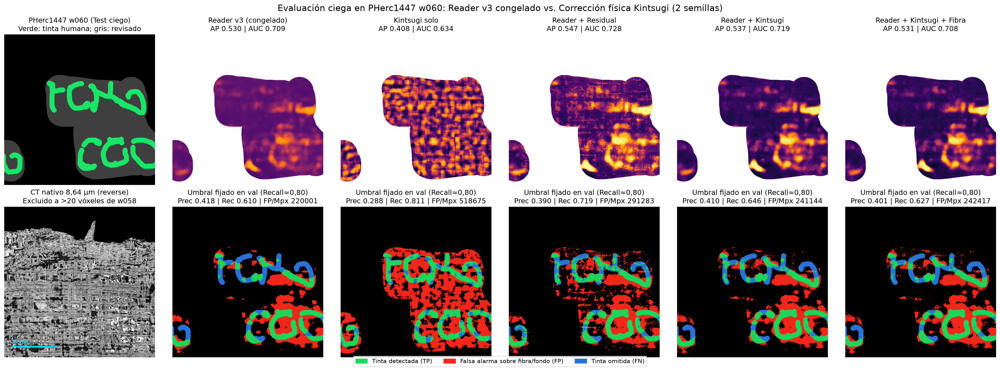
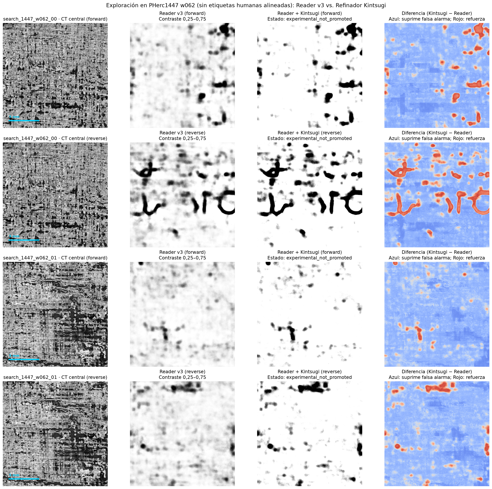

# Reader v3 + Kintsugi en PHerc1447 — 25/10/2026

## Resultado

**Ninguna variante superó la regla de promoción fijada antes de abrir el test (`promoted_model = null`).** Usar `Reader v3` como base mejora mucho a Kintsugi en solitario, pero los módulos físicos de Kintsugi **no aportan una ventaja demostrada** frente a una corrección residual sin física. En el test sellado, la mejor AP la obtiene precisamente la corrección **sin física** (`Reader + Residual`).

- Gasto de la tanda, incluida la interrupción de red y la reanudación: **0,4319 USD** (NVIDIA A40, 0,59 USD/h, CA-MTL-1).
- Saldo tras el cierre: **6,03 USD**; gasto activo 0 USD/h, **0 pods y 0 volúmenes** verificados.

## Protocolo

Fijado en [reader_kintsugi_20261025.json](../configs/reader_kintsugi_20261025.json) antes de cargar etiquetas de test o predicciones.

- Etiquetas humanas de [YoussefMoNader/ink-8um-pherc1447-surfaces](https://huggingface.co/datasets/YoussefMoNader/ink-8um-pherc1447-surfaces) (CC-BY-NC-4.0), revisión `7e4d918`. Las salidas de Reader son una entrada congelada, nunca pseudoetiquetas.
- Entrenamiento: PHerc0139 w035 y w040 + mitad izquierda de PHerc1447 w058.
- Validación: mitad derecha de w058, separada 768 píxeles nativos.
- Test: PHerc1447 w060, excluyendo la geometría a menos de 20 vóxeles de la superficie de entrenamiento (1.752.722 píxeles revisados, 454.143 de tinta).
- Cuatro variantes, semillas 1337 y 2027, 2000 pasos, parches 128 × 128, 17 capas nativas a 8,64 µm. Pesos y umbral (recall 0,80) elegidos solo con validación.
- Orientación de capas de PHerc1447 elegida una sola vez con el recorte de entrenamiento: **reverse** (AP 0,7251 frente a 0,3180 en forward) y congelada para todas las particiones.

## Resultados (media de dos semillas)

### Validación, w058 derecha, recall fijado en 0,80

| Modelo | Parámetros entrenables | AP | AUC | Precisión | FP/Mpx |
|---|---:|---:|---:|---:|---:|
| Reader v3 congelado | 0 | 0,7177 | 0,8637 | 0,5312 | 164.546 |
| Kintsugi solo | 296.164 | 0,3325 | 0,6254 | 0,2725 | 497.748 |
| Reader + Residual (sin física) | 92.597 | 0,7165 | 0,8599 | 0,4871 | 196.332 |
| Reader + Kintsugi | 296.167 | 0,7195 | 0,8651 | 0,5273 | 167.157 |
| Reader + Kintsugi + fibra | 296.167 | 0,7177 | 0,8670 | 0,5362 | 161.284 |

La regla exigía +0,01 de AP y +0,03 de precisión sobre Reader. La mejor mejora en precisión fue +0,005 (variante con fibra).

### Test sellado, w060, umbrales congelados en validación

| Modelo | AP | AUC | Precisión | Recall | FP/Mpx |
|---|---:|---:|---:|---:|---:|
| Reader v3 congelado | 0,5300 | 0,7094 | **0,4179** | 0,6095 | **220.001** |
| Kintsugi solo | 0,4083 | 0,6345 | 0,2883 | 0,8111 | 518.675 |
| Reader + Residual (sin física) | **0,5475** | **0,7280** | 0,3900 | 0,7187 | 291.283 |
| Reader + Kintsugi | 0,5368 | 0,7189 | 0,4098 | 0,6463 | 241.144 |
| Reader + Kintsugi + fibra | 0,5307 | 0,7076 | 0,4012 | 0,6267 | 242.417 |



## Interpretación

1. **Kintsugi aprende mejor como corrector que desde cero.** AP de test 0,4083 en solitario frente a 0,5368 encima de Reader.
2. **Las correcciones sobre Reader son pequeñas.** La mayor ganancia en AP de test es +0,0175 (Residual). Con dos semillas y una sola ventana de test, diferencias de este tamaño no están establecidas.
3. **La física no se distingue de la corrección residual.** La penalización de fibras redujo las falsas alarmas en validación, pero esa ventaja no se trasladó a w060. Sus diferencias de recall y FP en test se explican sobre todo por un umbral más alto, sin mejor ordenación.
4. **El cuello de botella es la transferencia entre vueltas del rollo.** Reader cae de AP 0,7177 en w058 a 0,5300 en w060, y su umbral calibrado en validación sólo recupera el 61 % de la tinta de test.

## Exploración en PHerc1447 w062

Dos recortes nativos de 2048 × 2048, en ambas orientaciones, con Reader y con `Reader + Kintsugi` (variante física con mejor AP de validación, marcada `experimental_not_promoted`).



En `w062_00`, orientación reverse, ambos modelos muestran trazos curvos con aspecto de caracteres. Kintsugi aumenta el contraste de esos trazos y baja el fondo, sin crear formas que Reader no tuviera. **No es un descubrimiento:** el conjunto de origen ya publica predicciones de modelos para w062, no hay etiquetas humanas alineadas para medirlo y no se ha comprobado su lectura con expertos.

## Reproducción

```bash
PYTHONPATH=. python scripts/prepare_reader_kintsugi.py
PYTHONPATH=. python scripts/run_controlled_runpod.py --study reader-kintsugi --max-spend 3 --data-center CA-MTL-1 --gpu-id "NVIDIA A40"
PYTHONPATH=. python scripts/render_reader_kintsugi.py
```

El lanzador limita el gasto, reutiliza el volumen de un intento cortado, reanuda modelos ya terminados, descarga y verifica los checkpoints antes de borrar pod y volumen, y no publica en GitHub. Los datos CT, etiquetas y pesos de Reader quedan en local (`data/`, excluido de Git).

## Siguiente paso con más valor

Sin etiquetas de otra vuelta del rollo no se puede distinguir una mejora real de ruido entre semillas. Lo prioritario sería: más semillas y ventanas de test independientes; evaluar con varias vueltas de PHerc1447; y estudiar la alineación de superficie y la selección de profundidad, que explican mejor la caída de Reader entre w058 y w060 que cualquier cambio de arquitectura.
